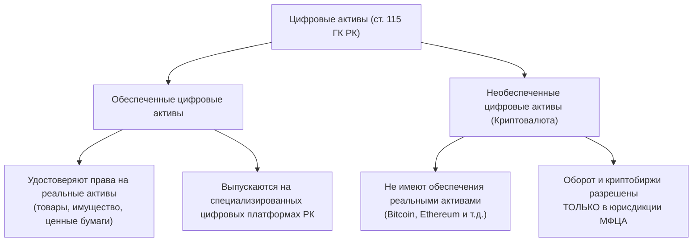
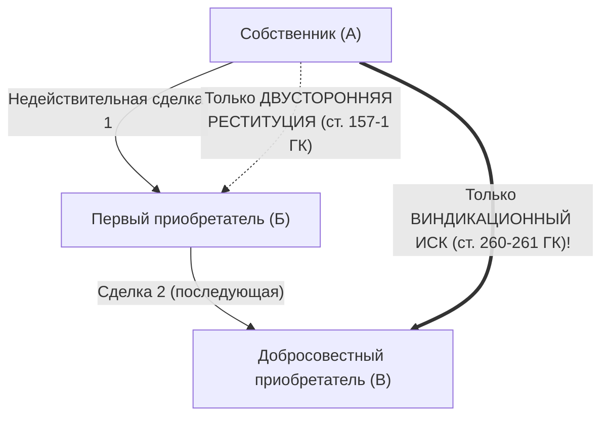

# Дополнения к конспектам по Гражданскому праву РК (Общая часть): Чанк GP-2 (Вопросы 19–39)

Данный документ содержит углубленный правовой материал по темам, раскрытым в конспектах пользователя частично (`coverage: partial`). Материал полностью адаптирован под стиль конспектов пользователя в Obsidian и нормативную базу Республики Казахстан на 2026 год.

---

## Вопрос 19. Прекращение юридических лиц.
> [!info] Чего не хватало в конспекте:
> Институт несостоятельности (банкротства) юридических лиц: основания признания банкротом, критерии неплатежеспособности, процедуры (реабилитационная процедура, ликвидация банкрота, мировое соглашение), правовой статус банкротного управляющего и формирование ликвидационной массы по Закону РК «О реабилитации и банкротстве» от 07.03.2014 г.

### 🏛️ Правовое регулирование несостоятельности и банкротства ЮЛ в РК
В соответствии с п. 1 ст. 49 ГК РК банкротство является самостоятельным основанием принудительной ликвидации юридического лица по решению суда. Специальным нормативным правовым актом выступает **Закон РК от 07.03.2014 г. № 176-V «О реабилитации и банкротстве»**.

#### 1. Разграничение понятий: Неплатежеспособность vs Несостоятельность (Банкротство)
- **Неплатежеспособность** — установленная судом неспособность должника в полном объеме исполнить денежные обязательства по оплате товаров (работ, услуг), выплате зарплаты, налоговым и неналоговым платежам.
- **Банкротство** — признанная решением суда несостоятельность должника, являющаяся основанием для его принудительной ликвидации.

> [!important] Критерии обращения в суд о банкротстве должника:
> 1. Неисполнение обязательств перед кредитором в течение **3 месяцев** с момента наступления срока их исполнения;
> 2. Общая сумма требований кредиторов (в совокупности):
>    - для субъектов малого предпринимательства — не менее **300 МРП**;
>    - для субъектов среднего предпринимательства — не менее **1 000 МРП**;
>    - для субъектов крупного предпринимательства — не менее **5 000 МРП**;
> 3. Наличие **устойчивой неплатежеспособности**: когда обязательства должника превышают стоимость его активов на дату подачи заявления и на начало года, в котором подано заявление.

#### 2. Процедуры, применяемые в отношении юридического лица-должника

| Процедура | Цель и сущность | Сроки | Ключевой субъект |
| :--- | :--- | :--- | :--- |
| **Реабилитационная процедура** | Судебная процедура, применяемая к неплатежеспособному должнику, направленная на восстановление его платежеспособности в целях предотвращения ликвидации | До **5 лет** (может продлеваться судом до 1 года) | **Реабилитационный управляющий** |
| **Процедура банкротства (ликвидация)** | Судебная процедура ликвидации несостоятельного должника с продажей имущества и распределением вырученных средств между кредиторами | **9 месяцев** (продление судом до 2 лет) | **Банкротный управляющий** |
| **Мировое соглашение** | Процедура достижения договоренности между должником и кредиторами об отсрочке, рассрочке или прощении долгов на любой стадии | Устанавливается соглашением | Утверждается судом |

#### 3. Правовой режим банкротного управляющего и ликвидационной массы
- С момента вынесения решения суда о признании ЮЛ банкротом:
  1. Органы управления должника отстраняются; все полномочия по управлению имуществом переходят к **банкротному управляющему**;
  2. Прекращается начисление неустойки (штрафов, пени) и вознаграждения (интереса) по всем видам задолженности;
  3. Снимаются все ранее наложенные аресты на имущество должника;
  4. Сроки всех долговых обязательств должника считаются наступившими;
  5. Любые имущественные претензии кредиторов могут быть предъявлены только в рамках процедуры банкротства.
- **Формирование ликвидационной конкурсной массы:** все имущество должника, за исключением имущества, изъятого из оборота, и личных неимущественных прав.
- **Очередность при банкротстве:** регулируется ст. 100 Закона «О реабилитации и банкротстве» (отдельный порядок от общей ликвидации по ст. 51 ГК РК; судебные расходы и расходы по банкротству погашаются вне очереди!).

#### 4. Субсидиарная ответственность учредителей при преднамеренном банкротстве
Если банкротство юридического лица вызвано действиями (бездействием) его учредителя (участника) или должностного лица, при недостаточности имущества банкрота на таких лиц возлагается **субсидиарная имущественная ответственность** по обязательствам должника всем своим личным имуществом (ст. 6 Закона «О реабилитации и банкротстве», ст. 44 ГК РК).

**Связи:** [[Юридические лица как субъекты гражданских прав]], [[Рубежка]]

---

## Вопрос 25. Некоммерческие организации в системе гражданского законодательства: общая характеристика, виды.
> [!info] Чего не хватало в конспекте:
> Судьба ликвидационного остатка имущества различных видов НКО (ст. 106, 107, 108, 110 ГК РК и Закон «О некоммерческих организациях»), а также специальные современные формы НКО по отраслевому законодательству РК (ОСИ по Закону «О жилищных отношениях», автономные организации образования — АОО, профессиональные саморегулируемые палаты — нотариусы, адвокаты, юридические консультанты).

### 🏛️ Судьба ликвидационного остатка имущества НКО
Главный цивилистический тест на понимание природы некоммерческой организации — кому достается имущество после удовлетворения всех требований кредиторов при ликвидации ЮЛ:

| Организационно-правовая форма НКО | Судьба ликвидационного остатка имущества | Нормативное обоснование |
| :--- | :--- | :--- |
| **Общественное объединение (ОО)** | **Категорически не распределяется** между членами. Направляется на цели, предусмотренные уставом ОО, либо на благотворительность. При споре — решение принимает суд | п. 3 ст. 106 ГК РК, ст. 21 Закона «Об ОО» |
| **Общественный фонд** | **Категорически не распределяется** между учредителями и работниками фонда. Передается на уставные цели фонда либо сходные благотворительные цели | ст. 107 ГК РК, ст. 30 Закона «О НКО» |
| **Религиозное объединение (РО)** | Не распределяется между членами; используется на религиозные/благотворительные уставные цели либо переходит государству | ст. 109 ГК РК |
| **Учреждение (ГУ, ЧУ)** | Имущество передается **собственнику имущества** (государству либо частному учредителю) | ст. 105 ГК РК |
| **Потребительский кооператив (ПК)** | **Распределяется между членами кооператива** пропорционально их паевым взносам (поскольку члены сохраняют обязательственные права на свои паи) | ст. 108 ГК РК |
| **Ассоциация (союз) ЮЛ и ИП** | Направляется на уставные цели ассоциации либо распределяется между участниками, если это прямо предусмотрено ее учредительными документами | ст. 110 ГК РК, ст. 31 Закона «О НКО» |

### 🏢 Специальные формы НКО в законодательстве Республики Казахстан
Помимо традиционных форм, прямо поименованных в ст. 105–110 ГК РК, законодательство Казахстана предусматривает открытый перечень специальных форм некоммерческих организаций:

#### 1. Объединение собственников имущества (ОСИ)
- **Нормативная база:** Закон РК «О внесении изменений и дополнений в некоторые законодательные акты РК по вопросам жилищно-коммунального хозяйства» и Закон РК «О жилищных отношениях».
- **Правовая природа:** некоммерческая организация, создаваемая собственниками квартир и нежилых помещений одного многоквартирного жилого дома (МЖД) для совместного управления объектом кондоминиума, финансирования его содержания и обеспечения его сохранности.
- **Принцип:** «Один дом — одно ОСИ — один счет».
- **Особенности:** председатель ОСИ избирается из числа собственников сроком на один год. ОСИ не вправе заниматься коммерческой деятельностью, выходящей за пределы управления МЖД.

#### 2. Автономная организация образования (АОО)
- **Нормативная база:** Закон РК от 19.01.2011 г. «О статусе "Назарбаев Университет", "Назарбаев Интеллектуальные школы" и "Назарбаев Фонд"».
- **Правовая природа:** не имеющая членства некоммерческая организация, наделенная особым правовым статусом, создаваемая для реализации образовательных программ и научных проектов мирового уровня.
- **Специфика:** вправе самостоятельно утверждать образовательные стандарты, распоряжаться имуществом без оглядки на стандартные процедуры госзакупок, создавать целевые фонды эндаумента.

#### 3. Палаты с обязательным профессиональным членством (Саморегулируемые организации в сфере юриспруденции)
- **Нотариальная палата** (Закон РК «О нотариате») — объединяет нотариусов региона, основана на обязательном членстве частных нотариусов;
- **Коллегия адвокатов** (Закон РК «Об адвокатской деятельности и юридической помощи») — объединяет адвокатов области/города республиканского значения;
- **Палата юридических консультантов** — объединяет лиц, оказывающих юридическую помощь в виде судебного представительства по гражданским делам.

**Связи:** [[Юридические лица как субъекты гражданских прав]], [[Рубежка]]

---

## Вопрос 29. Деньги и ценные бумаги как объекты гражданских прав. Результаты интеллектуальной деятельности, информация как объекты гражданских прав.
> [!info] Чего не хватало в конспекте:
> Гражданско-правовой режим цифровых активов (обеспеченные и необеспеченные цифровые активы по Закону РК «О цифровых активах в Республике Казахстан» от 06.02.2023 г., включенные в п. 2 ст. 115 ГК РК) и правовой статус цифрового тенге как третьей формы национальной валюты Республики Казахстан.

### 🌐 Цифровые активы как объекты гражданских прав в РК
Законом РК от 06.02.2023 г. № 193-VII в ст. 115 ГК РК было внесено прямое указание на то, что **цифровые активы относятся к имущественным благам и правам**.

#### 1. Легальное понятие цифрового актива
> **Цифровой актив** — это имущество, созданное в электронно-цифровой форме с применением средств криптографии и компьютерных вычислений, не являющееся финансовым инструментом или электронными деньгами, признаваемое объектом гражданских прав в соответствии с законодательством Республики Казахстан.

#### 2. Классификация цифровых активов по Закону РК от 06.02.2023 г.

1. **Обеспеченный цифровой актив:**
   - Цифровой актив, удостоверяющий права на материальные, интеллектуальные услуги и активы, за исключением денег и ценных бумаг.
   - Лицо, осуществившее выпуск, обязано обеспечить безусловное исполнение обязательств перед держателем цифрового актива.
2. **Необеспеченный цифровой актив (криптовалюта):**
   - Цифровой актив, полученный в информационной системе в виде вознаграждения за участие в поддержании консенсуса (майнинг), не удостоверяющий чьих-либо обязательств.
   - **Правовой режим в РК:** оборот необеспеченных цифровых активов, деятельность криптовалютных бирж и обменных пунктов на территории Республики Казахстан разрешены **исключительно на территории Международного финансового центра «Астана» (МФЦА)** в рамках специального регуляторного режима (FinTech Lab комитета AFSA). За пределами МФЦА выпуск и оборот криптовалют в качестве платежного средства запрещен!

#### 3. Правовая специфика цифрового тенге (Digital Tenge)
- В 2023–2026 гг. Национальный Банк РК запустил национальную цифровую валюту центрального банка (CBDC) — **цифровой тенге**.
- **Юридическая природа:** цифровой тенге является **третьей формой законного платежного средства в Республике Казахстан** (наряду с наличными и безналичными деньгами).
- Является прямым безусловным обязательством Национального Банка РК.
- В отличие от безналичных денег на счетах в коммерческих банках, цифровой тенге объединяет свойства наличных (уникальный цифровой код/токен, возможность офлайн-платежей) и безналичных расчетов (мгновенность переводов, прозрачность целевого расходования через смарт-контракты).

**Связи:** [[Объекты гражданских прав]], [[Рубежка]]

---

## Вопрос 34. Недействительность сделок: понятие и правовые последствия признания сделок недействительными.
> [!info] Чего не хватало в конспекте:
> Соотношение последствий недействительности сделки (двусторонней реституции по ст. 157-1 ГК РК) с виндикационным иском по ст. 261 ГК РК (защита добросовестного приобретателя по разъяснениям Нормативного постановления Верховного Суда РК № 5 от 07.07.2016 г.), а также институт конвалидации (исцеления) сделок (ст. 154 п. 2, ст. 159 п. 2, 3 ГК РК).

### ⚖️ Реституция vs Виндикация: Разграничение по Нормативному постановлению ВС РК № 5 от 07.07.2016 г.
Один из сложнейших практических вопросов на экзамене — какую норму применять, если имущество по недействительной сделке было перепродано новому лицу?

> [!important] Ключевая правовая позиция Верховного Суда РК (п. 12, 13 НП ВС РК № 5):
> 1. **Реституция (ст. 157-1 ГК РК)** носит сугубо обязательственный характер и действует **только между сторонами недействительной сделки** (между А и Б).
> 2. Применение реституции к третьему лицу (В), не являвшемуся стороной первой сделки, **не допускается!**
> 3. Если имущество уже отчуждено третьему лицу, первоначальный собственник может защитить свои права **только путем подачи виндикационного иска** об истребовании имущества из чужого незаконного владения (ст. 260, 261 ГК РК).
> 4. При виндикации третье лицо (В) признается **добросовестным приобретателем**, если оно не знало и не должно было знать о неправомерности отчуждения. У добросовестного приобретателя имущество может быть истребовано **только в случаях, прямо предусмотренных п. 1 ст. 261 ГК РК**:
>    - если имущество приобретено **безвозмездно** (дарение, наследство);
>    - либо если имущество выбыло из владения собственника **помимо его воли** (утеряно, похищено).
> 5. Если же собственник сам добровольно передал вещь контрагенту по недействительной сделке (хотя бы и под влиянием обмана!), а приобретатель возмездно продал ее добросовестному третьему лицу, **имущество у добросовестного приобретателя не изымается!** Собственник вправе взыскать лишь убытки (стоимость имущества) со своего непосредственного контрагента.

### 🩹 Институт конвалидации (исцеления) недействительных сделок в ГК РК
**Конвалидация** (от лат. *convalidatio*) — признание судом изначально недействительной или дефектной сделки имеющей полную юридическую силу при наступлении определенных законом условий:

1. **Конвалидация сделки с пороком нотариальной формы (п. 2 ст. 154 ГК РК):**
   Если сделка, требующая нотариального удостоверения, фактически исполнена одной из сторон полностью или в части, а другая сторона уклоняется от нотариального удостоверения сделки, суд вправе по требованию исполнившей стороны признать сделку действительной. В этом случае последующее обращение к нотариусу не требуется; решение суда заменяет нотариальный акт.
2. **Конвалидация сделки несовершеннолетнего от 14 до 18 лет (п. 2 ст. 159 ГК РК):**
   Сделка несовершеннолетнего, совершенная без необходимого согласия родителей, может быть признана судом действительной при условии, если она совершена к выгоде несовершеннолетнего, либо если родители впоследствии письменно одобрили эту сделку.
3. **Конвалидация сделки недееспособного гражданина (п. 3 ст. 159 ГК РК):**
   Хотя сделка гражданина, признанного недееспособным, ничтожна, закон делает важнейшее исключение: по требованию опекуна такая сделка может быть признана судом действительной, если она совершена **к несомненной выгоде недееспособного гражданина** (например, выгодный обмен жилья).

**Связи:** [[Сделки]], [[Рубежка]]
