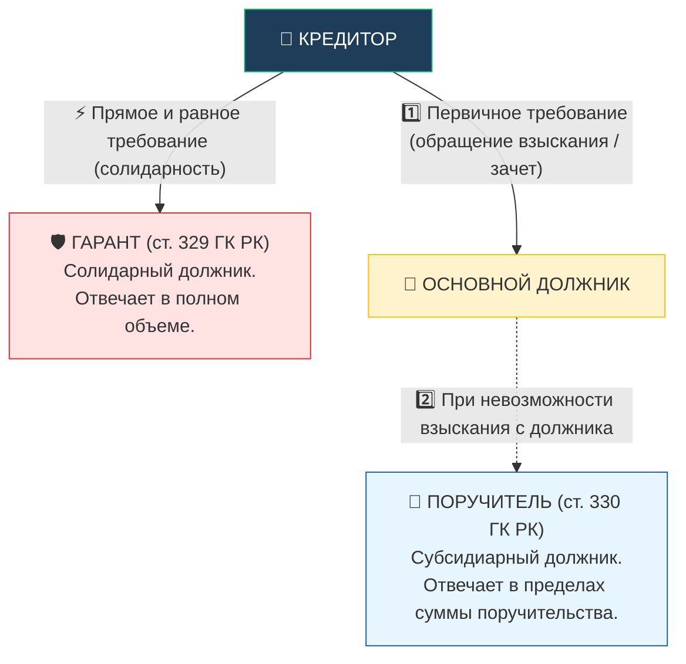

# Дополнения к конспектам по Гражданскому праву РК (Общая часть)
## Чанк 4: Обязательственное и договорное право (Вопросы 57–73)

> [!abstract] Обзор пробелов
> Из 17 вопросов силлабуса:
> - **Full (полное соответствие конспекту):** 14 вопросов (gp-57, gp-58, gp-59, gp-61, gp-62, gp-63, gp-65, gp-67, gp-68, gp-69, gp-70, gp-71, gp-72, gp-73)
> - **Partial (частичное покрытие / обнаруженные пробелы):** 3 вопроса (gp-60, gp-64, gp-66)
> - **None (отсутствует в конспекте):** 0 вопросов

---

## Вопрос 60. Специфика исполнения денежных обязательств
> [!info] Чего не хватало в конспекте:
> В конспекте кратко упомянуто правило о тенге, но не раскрыта очередность погашения требований по денежному обязательству (п. 2 ст. 282 ГК РК), правила погашения однородных требований по нескольким долгам (ст. 283 ГК РК), применение валютной оговорки (п. 3 ст. 282 ГК РК) и ответственность за неправомерное пользование чужими деньгами (ст. 353 ГК РК).

### 🏛️ Специфика исполнения денежных обязательств в Республике Казахстан

> [!abstract] Легальная база денежных обязательств
> - **ст. 127 ГК РК:** Деньги (валюта) как объект гражданских прав. Законное платежное средство — тенге.
> - **ст. 282 ГК РК:** Валюта денежных обязательств, валютная оговорка и очередность погашения долга.
> - **ст. 283 ГК РК:** Очередность погашения однородных требований по нескольким обязательствам.
> - **ст. 353 ГК РК:** Ответственность за неправомерное пользование чужими деньгами (базовая ставка НБ РК).

#### 1. Национальная валюта и валютная оговорка (ст. 282 ГК РК)
- **Принцип платежа в тенге:** денежные обязательства на территории РК должны быть выражены в тенге (п. 1 ст. 282 ГК РК). Использование иностранной валюты и платежных документов в инвалюте допускается только в строго предусмотренных валютным законодательством РК случаях (Закон РК «О валютном регулировании и валютном контроле»).
- **Валютная оговорка (п. 3 ст. 282 ГК РК):** в денежном обязательстве может быть предусмотрено, что оно подлежит оплате в тенге в сумме, эквивалентной определенной сумме в иностранной валюте или в условных денежных единицах. В этом случае сумма, подлежащая уплате в тенге, определяется по официальному курсу соответствующей валюты на день платежа, если иной курс или иная дата его определения не установлены законодательными актами или соглашением сторон.

#### 2. Очередность погашения требований по денежному обязательству (п. 2 ст. 282 ГК РК)
Сумма произведенного платежа, недостаточная для исполнения денежного обязательства полностью, при отсутствии иного соглашения сторон погашает требования в следующей строгой очередности:
1. **Первая очередь:** издержки кредитора по получению исполнения (судебные расходы, оплата услуг представителя, почтовые и транспортные издержки);
2. **Вторая очередь:** неустойка (штраф, пеня) и вознаграждение (проценты за пользование займом);
3. **Третья очередь:** основная сумма долга (тело кредита / основной долг).

#### 3. Погашение однородных требований по нескольким обязательствам (ст. 283 ГК РК)
Если должник обязан уплатить кредитору по нескольким однородным обязательствам, и произведенного платежа недостаточно для погашения всех:
- Платеж засчитывается в счет того обязательства, которое **указал должник** при исполнении или без промедления после исполнения;
- Если должник не воспользовался этим правом, исполнение засчитывается в счет обязательства, **срок исполнения которого наступил ранее**;
- Если сроки исполнения обязательств наступили одновременно, исполнение засчитывается **пропорционально** в погашение всех обязательств.

#### 4. Ответственность за нарушение денежного обязательства (ст. 353 ГК РК)
За неправомерное удержание чужих денег, уклонение от их возврата, иную просрочку в их уплате подлежит уплате неустойка. Размер неустойки исчисляется исходя из **базовой ставки Национального Банка Республики Казахстан** на день исполнения обязательства или его соответствующей части.

**Связи:** [[Понятие и стороны обязательства. Исполнение обязательств]], [[Гражданско-правовая ответственность за нарушение обязательства]]

---

## Вопрос 64. Гарантия и поручительство: понятие, основания возникновения и прекращения
> [!info] Чего не хватало в конспекте:
> В конспекте перепутаны понятия гарантии и поручительства (в схеме и таблице ошибочно указано, что поручитель отвечает солидарно, а гарант субсидиарно). По ГК РК (ст. 329, 330, 332): гарант отвечает солидарно, а поручитель — субсидиарно. Не раскрыты детальные правила предъявления требований к поручителю по ст. 332 п. 3 ГК РК.

### 🏛️ Гарантия и поручительство: устранение коллизии и точный правовой режим по ГК РК

> [!CAUTION] Важнейшая ловушка цивилистики РК (ст. 329, 330, 332 ГК РК)
> В казахстанском праве понятия **гарантии** и **поручительства** прямо противоположны терминологии Гражданского кодекса РФ!
> - В ГК РК **ГАРАНТИЯ — СОЛИДАРНАЯ** ответственность (ст. 329 ГК РК).
> - В ГК РК **ПОРУЧИТЕЛЬСТВО — СУБСИДИАРНАЯ** ответственность (ст. 330 ГК РК).

#### 1. Сравнительный анализ гарантии и поручительства в Республике Казахстан

| Критерий разграничения | Гарантия (ст. 329, п. 2 ст. 332 ГК РК) | Поручительство (ст. 330, п. 3 ст. 332 ГК РК) |
| :--- | :--- | :--- |
| **Характер ответственности** | **Солидарная ответственность** гаранта с должником | **Субсидиарная (дополнительная)** ответственность поручителя |
| **Порядок обращения кредитора** | Кредитор вправе сразу адресовать требование напрямую гаранту (полностью или в части) | Кредитор **обязан предварительно принять меры** к удовлетворению требования должником |
| **Объем ответственности** | Отвечает в том же объеме, что и должник (включая неустойку, проценты, убытки) | Отвечает строго **в пределах суммы**, указанной в договоре поручительства |
| **Субъектный состав на практике** | Чаще коммерческие банки, финансовые институты, квазигоссектор | Чаще физические лица, участники/учредители компаний, родственники |
| **Форма сделки** | Письменная форма (ст. 331 ГК РК) под страхом недействительности | Письменная форма (ст. 331 ГК РК) под страхом недействительности |

#### 2. Основания и сроки прекращения гарантии и поручительства (ст. 336 ГК РК)
1. С прекращением обеспеченного обязательства;
2. При изменении обеспеченного обязательства, влекущем увеличение ответственности или иные неблагоприятные последствия для гаранта/поручителя, **без его письменного согласия**;
3. При переводе долга на другое лицо без согласия гаранта/поручителя;
4. Если кредитор отказался принять надлежащее исполнение, предложенное должником или поручителем;
5. По истечении срока, на который дана гарантия/поручительство. Если срок не установлен, обеспечение прекращается, если кредитор в течение **одного года** со дня наступления срока исполнения обязательства не предъявит иск к гаранту/поручителю.

**Связи:** [[Обеспечение исполнения обязательств]], [[Гражданско-правовая ответственность за нарушение обязательства]]

---

## Вопрос 66. Перепоручение и переадресовка исполнения обязательств
> [!info] Чего не хватало в конспекте:
> В конспекте перепоручение (ст. 276 ГК РК) и проверка полномочий кредитора (ст. 275 ГК РК) упомянуты бегло. Отсутствует четкое разграничение переадресовки исполнения (ст. 275 ГК РК) с договором в пользу третьего лица (ст. 391 ГК РК) и с институтом перевода долга/цессии, а также последствия исполнения ненадлежащему лицу.

### 🏛️ Перепоручение и переадресовка исполнения обязательств

> [!abstract] Нормативная основа
> - **ст. 275 ГК РК:** Исполнение обязательства надлежащему лицу (переадресовка и проверка полномочий).
> - **ст. 276 ГК РК:** Возложение исполнения обязательства на третье лицо (перепоручение).
> - **ст. 363 ГК РК:** Ответственность должника за действия третьих лиц.
> - **ст. 391 ГК РК:** Договор в пользу третьего лица (разграничение).

#### 1. Перепоручение исполнения обязательства (ст. 276 ГК РК)
- **Сущность:** должник вправе возложить исполнение своего обязательства в целом или в части на третье лицо, если это предусмотрено законодательством, договором или если третье лицо связано с должником договором (например, генеральный подрядчик привлекает субподрядчика по ст. 619 ГК РК).
- **Исключения (недопустимость перепоручения):** не допускается, если из законодательства, договора или самого существа обязательства вытекает обязанность должника исполнить обязательство **лично** (творческие договоры, консультационные услуги, медицинские услуги, авторский заказ).
- **Ответственность за третье лицо (ст. 363 ГК РК):** третье лицо НЕ становится стороной основного обязательства. За его ошибки, недостатки и просрочку перед кредитором в полном объеме отвечает сам должник.

#### 2. Переадресовка исполнения обязательства (ст. 275 ГК РК)
- **Сущность:** кредитор вправе указать третье лицо, которому должник обязан вручить предмет исполнения (грузополучатель в договоре поставки, банк кредитора).
- **Проверка полномочий:** должник вправе при исполнении потребовать доказательств того, что исполнение принимается самим кредитором или управомоченным на это лицом, и несет риск последствий непредъявления такого требования. Если должник передал имущество неуполномоченному лицу, обязательство не считается исполненным.

#### 3. Сопоставительная таблица институтов

| Институт | Кто заменяется / привлекается | Требуется ли согласие контрагента | Кто отвечает перед кредитором |
| :--- | :--- | :--- | :--- |
| **Перепоручение (ст. 276 ГК РК)** | Должник привлекает фактического исполнителя (субподрядчика) | Нет, если нет условия о личном исполнении | Сам первоначальный должник (ст. 363 ГК) |
| **Переадресовка (ст. 275 ГК РК)** | Кредитор указывает лицо для приема исполнения | Нет (по указанию кредитора) | Должник отвечает за вручение надлежащему адресату |
| **Перевод долга (ст. 348 ГК РК)** | Должник полностью выбывает, заменяясь новым | **Да, строго обязательно согласие кредитора** | Новый должник |
| **Уступка требования (ст. 339 ГК РК)** | Кредитор выбывает, заменяясь новым (цессионарием) | Нет (требуется лишь уведомление должника) | Должник исполняет новому кредитору |
| **Договор в пользу третьего лица (ст. 391 ГК)** | Третье лицо наделяется самостоятельным правом требования | Устанавливается соглашением сторон договора | Должник отвечает непосредственно перед третьим лицом |

**Связи:** [[Понятие и стороны обязательства. Исполнение обязательств]], [[Гражданско-правовой договор]]
