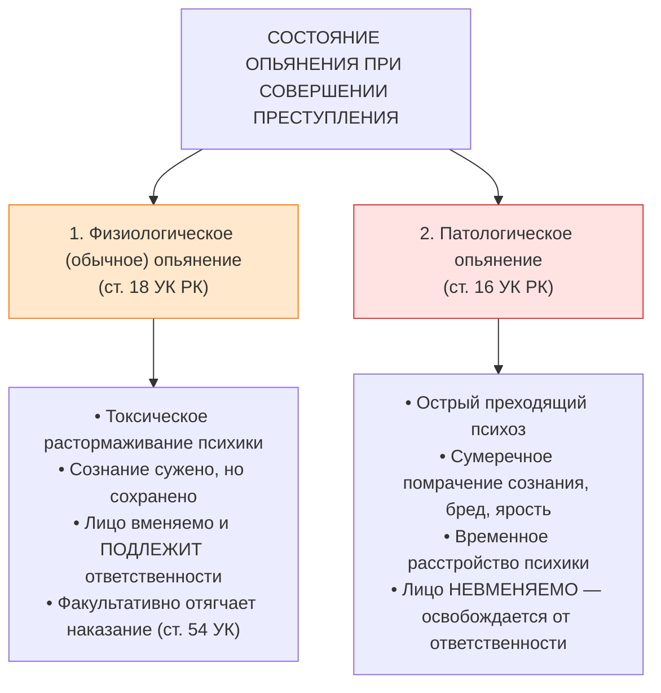
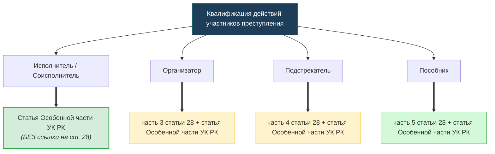

## Вопрос 51. Понятие и значение вменяемости.
> [!info] Чего не хватало в конспекте:
> В конспекте вменяемость дана в одном предложении без детального разбора интеллектуального и волевого критериев, презумпции вменяемости и её уголовно-политического значения как предпосылки вины.

### 1. Понятие и социально-психологическая природа вменяемости
**Вменяемость** — это нормальное психическое состояние физического лица, выражающееся в его способности во время совершения уголовного правонарушения осознавать фактический характер и общественную опасность своих действий (бездействия) и руководить ими (**ст. 15, 16 УК РК**).

В уголовном праве Республики Казахстан категория вменяемости является медико-юридической характеристикой субъекта:
- Она отражает нормальный уровень развития сознания и воли человека, позволяющий адекватно воспринимать социально значимые запреты;
- Понятие вменяемости в законе прямо не сформулировано отдельной дефиницией, а выводится методом «от противного» из нормы о невменяемости (**ч. 1 ст. 16 УК РК**).

### 2. Структура вменяемости: два взаимосвязанных критерия

| Критерий | Содержание признака | Проявление при совершении деяния |
| :--- | :--- | :--- |
| **Интеллектуальный** | Способность осознавать фактическую сторону деяния и его общественную опасность | Субъект понимает фактические обстоятельства происходящего (обстановку, применяемые орудия, причинно-следственные связи) и осознает социальную вредоносность посягательства для охраняемых общественных отношений. |
| **Волевой** | Способность свободно определять поведение и руководить своими поступками | Субъект обладает свободой воли, способен делать осознанный выбор между правомерным и преступным поведением, сдерживать противоправные импульсы и управлять своими телодвижениями. |

> [!IMPORTANT] Значение свободы воли (диалектический детерминизм)
> Человек признается вменяемым постольку, поскольку при детерминированности его поступков внешними факторами он сохраняет способность избирать линию поведения «со знанием дела». Если болезнь лишает его этой свободы, уголовная ответственность теряет морально-правовой смысл.

### 3. Презумпция вменяемости в уголовном судопроизводстве
В казахстанском уголовном праве и процессе действует **презумпция вменяемости**:
1. Любое лицо, достигшее возраста уголовной ответственности (**ст. 15 УК РК**), презюмируется вменяемым.
2. Сторона обвинения не обязана изначально доказывать вменяемость каждого обвиняемого специальными медицинскими экспертизами.
3. Бремя опровержения презумпции возникает при наличии обоснованных сомнений в психическом здоровье (неадекватное поведение, учет у психиатра, перенесенные тяжелые травмы мозга).
4. В силу **п. 2 ст. 271 УПК РК** назначение и производство судебно-психиатрической экспертизы (СПЭ) **обязательно**, если необходимо установить психическое состояние подозреваемого, обвиняемого, когда возникает сомнение по поводу их вменяемости.

### 4. Соотношение уголовной вменяемости и гражданской дееспособности
- **Вменяемость (УК РК):** устанавливается строго ретроспективно — на конкретный момент совершения общественно опасного деяния («во время совершения»). Лицо может признаваться вменяемым в отношении кражи, но невменяемым в отношении убийства в бредовом психозе.
- **Дееспособность (ст. 17, 26 ГК РК):** устанавливается на перспективу в отношении всех имущественных и личных неимущественных сделок гражданским судом. Лицо, признанное недееспособным в гражданском процессе, не становится автоматически невменяемым в уголовном деле (требуется самостоятельная СПЭ по уголовному делу).

### 5. Уголовно-правовое значение вменяемости
1. **Конститутивный признак субъекта уголовного правонарушения:** субъект по ч. 1 ст. 15 УК РК — исключительно вменяемое физическое лицо;
2. **Обязательная предпосылка вины:** вина как психическое отношение лица к деянию (ст. 19 УК РК) не может существовать вне вменяемости;
3. **Непременное условие уголовной ответственности и наказания:** цели наказания (ст. 39 УК РК — исправление, восстановление социальной справедливости, частная и общая превенция) принципиально недостижимы при отсутствии у лица способности осознавать кару.

**Связи:** [[Объективные и субъективные признаки уголовного правонарушения]]

---

## Вопрос 54. Совершение преступления в состоянии опьянения.
> [!info] Чего не хватало в конспекте:
> В конспекте тезисно указано правило ст. 18 УК, но отсутствует анализ дифференциации физиологического и патологического опьянения, видов одурманивающих веществ, а также роли опьянения как отягчающего (ст. 54 УК) и квалифицирующего признака (ст. 345-1, 346 УК).

### 1. Нормативный принцип ответственности (ст. 18 УК РК)
> [!LAW] Часть 1 статьи 18 УК РК
> Лицо, совершившее уголовное правонарушение в состоянии опьянения, вызванном употреблением алкоголя, наркотических средств, психотропных веществ, их аналогов или других одурманивающих веществ, **подлежит уголовной ответственности**.

Обоснование ответственности базируется на классической римской доктрине ***actio libera in causa*** (действие, свободное в своей первопричине): лицо по собственной воле приводит себя в одурманенное состояние, сознавая риск утраты контроля, а потому обязано нести полную ответственность за все вызванные им последствия.

### 2. Дифференциация видов опьянения

| Критерий разграничения | Физиологическое опьянение | Патологическое опьянение |
| :--- | :--- | :--- |
| **Этиология** | Дозозависимая реакция на прием алкоголя/наркотиков | Острый психоз, возникающий внезапно даже от микродоз алкоголя на фоне переутомления, травм мозга |
| **Состояние сознания** | Контроль и самокритика снижены, но ориентировка в пространстве и времени сохранена | Тотальное помрачение сознания, галлюцинации, бредовые идеи преследования и нападения |
| **Характер поведения** | Поведение мотивировано эгоистическими импульсами, агрессией или бравадой | Автоматизированные яростные действия, не мотивированные реальной ситуацией |
| **Память (амнезия)** | Частичная забывчивость отдельных деталей (палимпсест) | Полная амнезия периода психоза с последующим глубоким терминальным сном |
| **Уголовно-правовая оценка** | **Вменяемость сохранена.** Ответственность наступает по **ст. 18 УК РК** | **Невменяемость.** Временное расстройство психики (**ст. 16 УК РК**). Освобождение от ответственности |

### 3. Уголовно-правовое значение опьянения
1. **Обстоятельство, отягчающее уголовную ответственность (п. 12 ч. 1 ст. 54 УК РК):**
   - Суд вправе признать состояние опьянения отягчающим обстоятельством;
   - *Важное правило:* признание не является автоматической обязанностью суда — закон указывает: *«суд вправе, в зависимости от характера правонарушения, не признать это обстоятельство отягчающим»* (например, при защите от нападения, когда опьянение не провоцировало посягательство).
2. **Конструктивный и квалифицирующий признак:**
   - **Статья 345-1 УК РК:** нарушение ПДД лицом в состоянии опьянения, повлекшее причинение вреда здоровью или смерть (выделено в самостоятельный тяжкий состав);
   - **Статья 346 УК РК:** управление ТС лицом, лишенным права управления и находящимся в состоянии опьянения (пожизненное лишение прав и строгие сроки лишения свободы).
3. **Принудительные меры безопасности и лечения (ст. 91, 95 УК РК):**
   - Если лицо совершило преступление и признано страдающим хроническим алкоголизмом или наркоманией, суд наряду с наказанием назначает принудительное лечение от алкоголизма/наркомании.

**Связи:** [[Объективные и субъективные признаки уголовного правонарушения]]

---

## Вопрос 63. Понятие и значение деятельного раскаяния и его отличие от добровольного отказа.
> [!info] Чего не хватало в конспекте:
> В конспекте по стадиям деятельное раскаяние лишь кратко упомянуто, а в конспекте по освобождению от ответственности не проведено прямое сопоставительное разграничение с добровольным отказом по признакам, моментам проявления и реабилитирующему характеру.

### 1. Понятие и правовая сущность деятельного раскаяния
**Деятельное раскаяние** — это добровольное позитивное посткриминальное поведение лица после совершения уголовного правонарушения, направленное на минимизацию общественно опасных последствий, содействие органам правосудия и заглаживание причиненного вреда (**ст. 65 УК РК**).

### 2. Условия освобождения от ответственности по ч. 1 ст. 65 УК РК
Освобождение в связи с деятельным раскаянием допускается при наличии совокупности обстоятельств:
1. Лицо совершило уголовное правонарушение **впервые**;
2. Деяние относится к категории **уголовных проступков**, **преступлений небольшой тяжести** либо **преступлений средней тяжести**;
3. Лицо добровольно явилось с повинной;
4. Активно способствовало раскрытию и расследованию правонарушения;
5. Загладило вред, причиненный правонарушением (возместило ущерб, принесло извинения).

> [!NOTE] Нормативное постановление Верховного Суда РК № 2 от 22.12.2016 г.
> Верховный Суд РК разъяснил, что явка с повинной признается добровольной лишь тогда, когда лицо обратилось в органы власти до того, как его причастность к преступлению была достоверно установлена следствием.

### 3. Сводная сравнительная таблица: Добровольный отказ vs Деятельное раскаяние

| Критерий разграничения | Добровольный отказ (ст. 26 УК РК) | Деятельное раскаяние (ст. 65 УК РК) |
| :--- | :--- | :--- |
| **Временной момент проявления** | **До окончания преступления** (на стадиях приготовления или неоконченного/оконченного покушения) | **После окончания преступления** (на стадии оконченного правонарушения) |
| **Характер волевого акта** | Чаще пассивный (прекращение начатых преступных действий) | Исключительно активный (явка с повинной, выдача орудий, заглаживание ущерба) |
| **Материально-правовая сущность** | Устраняет состав преступления в содеянном: лицо признается **не совершившим** задуманное деяние | Состав преступления **налицо в полном объеме**, вина доказана; раскаяние аннулирует лишь целесообразность кары |
| **Юридический характер основания** | **Реабилитирующее основание**: лицо не подлежит уголовной ответственности (состава нет) | **Нереабилитирующее основание**: дело прекращается по нереабилитирующим основаниям с согласия лица |
| **Категории правонарушений** | Применимо к **любым** преступлениям (включая особо тяжкие) | По общей норме — только к **проступкам, небольшой и средней тяжести** |
| **Правовые последствия** | Полное непривлечение к ответственности (кроме фактически содеянного) | Освобождение от ответственности по ст. 65 УК либо смягчение наказания по п. 4 ч. 1 ст. 53 УК |

### 4. Специальные виды деятельного раскаяния в Особенной части УК РК
Законодатель стимулирует отказ от продолжающейся преступной деятельности путем закрепления специальных примечаний к статьям Особенной части, где лицо освобождается от ответственности **независимо от тяжести совершенного преступления**:
- Примечание к **ст. 125 УК РК** (похищение человека) — освобождение при добровольном освобождении похищенного;
- Примечание к **ст. 255 УК РК** (акт терроризма) — освобождение лица, участвовавшего в подготовке, если оно предотвратило теракт;
- Примечание к **ст. 262 УК РК** (создание и руководство ОПГ) — освобождение лица, добровольно прекратившего участие и способствовавшего пресечению деятельности;
- Примечание к **ст. 367 УК РК** (дача взятки) — освобождение взяткодателя при добровольном сообщении органам и вымогательстве взятки;
- Примечание к **ст. 428 УК РК** (неповиновение в учреждениях УИС).

**Связи:** [[Неоконченное и оконченное преступление. Стадии преступления. Уголовная ответственность]], [[Освобождение от уголовной ответственности]]

---

## Вопрос 67. Основания и пределы ответственности соучастников.
> [!info] Чего не хватало в конспекте:
> В конспекте приведены формулы квалификации, но недостаточно подробно освещены правила пределов ответственности: ответственность за неудавшееся соучастие (ч. 4-5 ст. 29 УК), влияние личностных смягчающих и отягчающих обстоятельств (ст. 52-54 УК).

### 1. Единое материальное основание ответственности
Основание уголовной ответственности для соучастников является **общим и единым с исполнителем-одиночкой** — совершение деяния, содержащего все признаки состава уголовного правонарушения (**ст. 4 УК РК**). 

Хотя организатор, подстрекатель и пособник непосредственно не выполняют объективной стороны состава Особенной части (не стреляют, не изымают имущество), их действия признаются преступными в силу законодательной связки норм Особенной части со **статьей 28 Общей части УК РК**.

### 2. Принцип акцессорности и пределы ответственности соучастников (ст. 29 УК РК)
В уголовном праве РК ответственность соучастников базируется на принципе **ограниченной акцессорности**:
- Ответственность соучастников производна от действий исполнителя: стадия, на которой прервалась деятельность исполнителя, определяет стадию ответственности для соучастников;
- Однако соучастники отвечают **исключительно в пределах своего собственного умысла** (принцип субъективного вменения, **ст. 19 УК РК**).

### 3. Правила юридической квалификации действий соучастников

> [!WARNING] Совмещение ролей
> Если организатор или пособник одновременно непосредственно участвовали в совершении преступления в качестве соисполнителей, их деяние квалифицируется **только по статье Особенной части без ссылки на ст. 28 УК РК**.

### 4. Неудавшееся соучастие (части 4, 5 статьи 29 УК РК)
1. **Пресечение деятельности исполнителя (ч. 4 ст. 29 УК РК):**
   - Если исполнитель прервал деяние на стадии приготовления или покушения, организатор, подстрекатель и пособник привлекаются к ответственности за **соучастие в приготовлении** или **соучастие в покушении** (напр., ч. 5 ст. 28, ч. 3 ст. 24, ст. 188 УК РК).
2. **Неудавшееся подстрекательство / пособничество (ч. 5 ст. 29 УК РК):**
   - Если подстрекателю по не зависящим от него причинам не удалось склонить исполнителя к преступлению (тот категорически отказался либо сообщил в полицию), действия подстрекателя признаются самостоятельным **приготовлением к преступлению** (ч. 1 ст. 24, ч. 4 ст. 28 + статья Особенной части);
   - Аналогично квалифицируется неудавшееся пособничество, если исполнитель не воспользовался предложенными средствами.

### 5. Соучастие в преступлениях со специальным субъектом (ч. 5 ст. 29 УК РК)
Лицо, не являющееся субъектом уголовного правонарушения, специально указанным в соответствующей статье Особенной части УК РК (должностным лицом, военным), **не может являться исполнителем (соисполнителем)** данного правонарушения. Однако оно подлежит уголовной ответственности за содеянное в качестве **организатора, подстрекателя или пособника**.

### 6. Индивидуализация ответственности соучастников (ст. 52 УК РК)
- При назначении наказания суд учитывает характер и степень фактического участия каждого лица, значение этого участия для достижения цели преступления и влияние на характер и размер причиненного вреда;
- **Личностные обстоятельства** (несовершеннолетие, беременность, наличие малолетних детей, судимость, рецидив преступлений) **учитываются исключительно при назначении наказания тому соучастнику, к личности которого они относятся** (ч. 2 ст. 52 УК РК). На остальных участников эти признаки не распространяются.

**Связи:** [[Соучастие в совершении уголовного правонарушения]]
