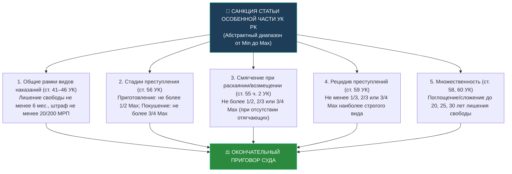

# Дополнения к конспектам по Уголовному праву (Общая часть, чанк up-6)

## Вопрос 89. Отличие уголовного наказания от дисциплинарных и административных мер
> [!info] Чего не хватало в конспекте:
> В конспекте пользователя подробно сопоставлены уголовное наказание и административное взыскание, а также меры пресечения и гражданско-правовая ответственность, но отсутствует детальное институциональное сопоставление с дисциплинарными взысканиями по трудовому и служебному праву РК (ст. 64–66 Трудового кодекса РК, Закон РК «О государственной службе Республики Казахстан»).

### 1. Теоретико-правовая основа разграничения
Меры государственного и квазигосударственного принуждения дифференцируются по отраслевой принадлежности норм, характеру охраняемых общественных отношений и степени тяжести последствий:
1. **Уголовное наказание (ст. 39 УК РК)** — реакция государства на уголовное правонарушение (преступление или уголовный проступок), представляющее наивысшую общественную опасность;
2. **Административное взыскание (ст. 40 КоАП РК)** — реакция уполномоченных органов государства на административное правонарушение, посягающее на правопорядок, права граждан и установленный порядок управления;
3. **Дисциплинарное взыскание (ст. 64 ТК РК)** — мера правового воздействия работодателя на работника за совершение дисциплинарного проступка (неисполнение или ненадлежащее исполнение трудовых обязанностей).

### 2. Сравнительная матрица видов принуждения в правовой системе РК

| Критерий | Уголовное наказание (ст. 39 УК РК) | Административное взыскание (ст. 40 КоАП РК) | Дисциплинарное взыскание (ст. 64–66 ТК РК) |
| :--- | :--- | :--- | :--- |
| **Нормативное основание** | Уголовный кодекс РК (ст. 4 УК) | Кодекс РК об административных правонарушениях (ст. 25 КоАП) | Трудовой кодекс РК, Закон «О государственной службе РК», дисциплинарные уставы |
| **Фактическое основание** | Совершение преступления или уголовного проступка | Совершение административного правонарушения | Совершение дисциплинарного проступка (нарушение трудовой дисциплины) |
| **Круг субъектов деликтности** | Вменяемое физическое лицо с 14 или 16 лет | Физическое лицо с 16 лет; юридическое лицо | Работник, состоящий в трудовых отношениях; государственный служащий |
| **Правоприменительный орган** | **Исключительно суд** (судья) обвинительным приговором | Суд (СМАС), уполномоченные госорганы (ОВД, налоговые, таможенные органы) | **Работодатель** (руководитель госоргана, командир) |
| **Процессуальный акт** | Обвинительный приговор суда именем Республики Казахстан | Постановление по делу об административном правонарушении | Приказ (распоряжение) работодателя |
| **Пределы правоограничений** | От штрафа до пожизненного лишения свободы (ст. 46 УК РК) | Предупреждение, штраф, административный арест (до 30 суток) | Замечание, выговор, строгий выговор, расторжение трудового договора |
| **Юридические последствия** | **Состояние судимости** (ст. 79 УК РК), возможность признания рецидива | Состояние подвергнутости взысканию в течение **1 года** (ст. 62 КоАП) | Действует не более **6 месяцев** (ст. 66 ТК РК); судимости не влечет |
| **Порядок исполнения и замены** | Уклонение влечет замену на более строгое наказание (ст. 41–44 УК) | Исполняется принудительно; замена арестом не допускается | Действует в рамках конкретного трудового договора |

### 3. Практический кейс: Разграничение при хищении имущества работодателя
> [!example] Анализ ситуации
> Бухгалтер ТОО «Альтаир» гражданка С. самовольно перевела с расчетного счета компании на свой личный счет 2 500 000 тенге.
> - **Квалификация:** Деяние содержит состав уголовного правонарушения, предусмотренного п. 1 ч. 2 ст. 189 УК РК (присвоение или растрата вверенного чужого имущества).
> - **Соотношение мер:** Возбуждение уголовного дела и вынесение обвинительного приговора судом с назначением уголовного наказания (например, ограничения свободы) не препятствует работодателю расторгнуть с ней трудовой договор по пп. 15 п. 1 ст. 52 ТК РК (в связи с совершением виновных действий работником, обслуживающим денежные ценности). При этом расторжение трудового договора является дисциплинарной мерой, а уголовное наказание — мерой публичной ответственности.

**Связи:** [[Понятие и цели наказания. Иные меры уголовно-правового воздействия]]

---

## Вопрос 97. Значение положений Общей и Особенной частей УК при назначении наказания
> [!info] Чего не хватало в конспекте:
> В конспекте темы «Назначение наказания» вопрос рассмотрен только как первый элемент общих начал (ст. 52 ч. 1 УК), без систематического раскрытия юридического механизма взаимосвязи диспозиций и санкций Особенной части с институтами Общей части (пределы видов наказаний, запрет двойного вменения, влияние неоконченного деяния, соучастия и рецидива).

### 1. Архитектура взаимодействия Общей и Особенной частей УК РК
В силу **ч. 1 ст. 52 УК РК**, лицу, признанному виновным, назначается наказание в пределах санкции статьи Особенной части и с учетом положений Общей части. Это закрепляет принцип их неразрывного диалектического единства:
- **Особенная часть** описывает признаки конкретного состава (диспозиция) и задает исходный диапазон ответственности (санкция);
- **Общая часть** задает правовые принципы, абсолютные границы конкретных видов наказаний, а также правила модификации («сжатия» или «сдвига») санкции статьи при наличии специальных институтов.

### 2. Системные механизмы влияния норм Общей части на санкцию Особенной части

### 3. Запрет двойного учета признаков (правило Non bis in idem)
Важнейшим связующим правилом между частями УК РК выступает запрет повторного учета обстоятельств:
- **По смягчающим обстоятельствам (ч. 3 ст. 53 УК РК):** если обстоятельство предусмотрено статьей Особенной части как признак состава (например, аффект в ст. 101 УК или новорожденность в ст. 100 УК), оно не может повторно учитываться как смягчающее;
- **По отягчающим обстоятельствам (ч. 2 ст. 54 УК РК, п. 4 НП ВС РК № 4 от 25.06.2015 г.):** если признак назван в квалифицированном составе (например, п. 1 ч. 2 ст. 188 УК — «группой лиц по предварительному сговору»), суд не вправе учитывать его как отягчающее обстоятельство по п. 3 ч. 1 ст. 54 УК РК при определении срока наказания.

**Связи:** [[Назначение наказания]]

---

## Вопрос 106. Исчисление сроков наказаний и зачёт наказания
> [!info] Чего не хватало в конспекте:
> В конспектах детально изложена таблица зачета содержания под стражей и домашнего ареста по ст. 62 УК РК, однако правила исчисления сроков при сложении и конвертации разнородных видов наказаний по статье 61 УК РК не были систематизированы.

### 1. Правила исчисления сроков наказания (ст. 61 ч. 1 УК РК)
Уголовный закон устанавливает дифференцированные единицы измерения сроков наказаний:
- **В месяцах и годах:** лишение права занимать определенную должность или заниматься определенной деятельностью, исправительные работы, ограничение свободы, арест, лишение свободы;
- **В часах:** привлечение к общественным работам (исчисляются в астрономических часах отбытого труда — ст. 43 УК).

### 2. Таблица эквивалентного перерасчета разнородных наказаний (ст. 61 ч. 2 УК РК)
При назначении наказания по совокупности уголовных правонарушений (ст. 58 УК) или совокупности приговоров (ст. 60 УК) разнородные наказания приводятся к общему знаменателю по следующей шкале:

| 1 день лишения свободы приравнивается к: | Эквивалентная мера другого вида |
| :--- | :--- |
| **Ограничение свободы** | 1 день ограничения свободы |
| **Арест** | 1 день (сутки) ареста |
| **Общественные работы** | 4 часа привлечения к общественным работам |
| **Исправительные работы** | Сумме исправительных работ, эквивалентной 4 МРП |
| **Штраф** | Сумме штрафа в размере 4 МРП |

> [!NOTE] Самостоятельное исполнение мер
> В силу ч. 2 ст. 61 УК РК штраф, исправительные работы и привлечение к общественным работам при сложении с ограничением свободы или лишением свободы могут по решению суда исполняться самостоятельно.

### 3. Коэффициенты зачета мер процессуального пресечения (ст. 62 УК РК)
1. **Содержание под стражей в СИЗО до вступления приговора в силу (ч. 3 ст. 62 УК):**
   - 1 день стражи = **1 день** лишения свободы в учреждениях *максимальной, чрезвычайной и полной безопасности*;
   - 1 день стражи = **1,5 дня** лишения свободы в учреждениях *средней и минимальной безопасности*;
   - 1 день стражи = **2 дня** ограничения свободы или исправительных работ;
   - 1 день стражи = **4 часа** общественных работ;
   - 1 день стражи = **4 МРП** штрафа.
2. **Домашний арест (ч. 4 ст. 62 УК):**
   - 1 день домашнего ареста = **1 день** лишения свободы;
   - 1 день домашнего ареста = **2 дня** ограничения свободы.

**Связи:** [[Назначение наказания]], [[Понятие и цели наказания. Иные меры уголовно-правового воздействия]]
