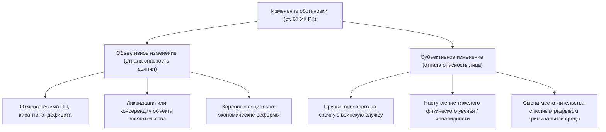
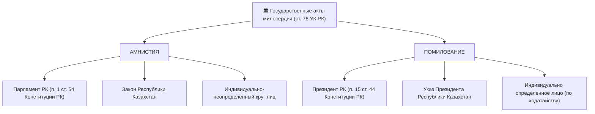

# Дополнения к конспектам по Уголовному праву РК (Чанк up-7)

## Вопрос up-2-42. Социальная и психологическая природа эксцесса обороны
> [!info] Чего не хватало в конспекте: В конспекте отсутствует детальный анализ ч. 2 ст. 66 УК РК (превышение мер задержания), критериев разграничения неожиданности нападения и аффекта, роли СППЭ и позиций НП ВС РК от 11.05.2007 г. № 2.

### Эксцесс обороны и эксцесс задержания: нормативная регламентация ст. 66 УК РК

Статья 66 УК РК содержит две самостоятельные поощрительные нормы, исключающие применение мер уголовной ответственности к гражданам при превышении пределов защитительных действий в условиях стресса.

#### 1. Превышение пределов необходимой обороны (ч. 1 ст. 66 УК РК)
Освобождается лицо, совершившее деяние при превышении пределов обороны (**ст. 102 УК РК** — убийство при превышении пределов необходимой обороны, либо **ст. 112 УК РК** — причинение тяжкого вреда здоровью при превышении пределов необходимой обороны), если это превышение было вызвано:
- **неожиданностью нападения**; ЛИБО
- **состоянием сильного душевного волнения (физиологического аффекта)**, вызванного насилием или непосредственной угрозой его применения.

#### 2. Превышение мер, необходимых для задержания правонарушителя (ч. 2 ст. 66 УК РК)
Освобождается лицо, превысившее меры при задержании лица, совершившего уголовное правонарушение (**ст. 102 или 112 УК РК**), если эксцесс был обусловлен:
- неожиданностью посягательства; ЛИБО
- тяжестью совершенного правонарушения.

#### Разграничение правомерной обороны и оснований ст. 66 УК РК

| Критерий | Необходимая оборона (ст. 32 УК РК) | Освобождение по ст. 66 УК РК |
| :--- | :--- | :--- |
| **Характер действий** | Правомерны, общественно полезны | Содержат признаки превышения пределов (эксцесс) |
| **Наличие состава** | **Состав деяния отсутствует** (ст. 32 УК) | **Состав доказан** (ст. 102 или 112 УК), нереабилитирующее основание |
| **Психологический фактор** | Любое психологическое состояние | **Неожиданность нападения** либо **физиологический аффект** |
| **Судебная экспертиза** | Оценивается факт нападения | **Обязательна судебно-психолого-психиатрическая экспертиза (СППЭ)** |

> [!IMPORTANT] Правовые позиции Верховного Суда РК (НП ВС РК от 11.05.2007 г. № 2)
> 1. Судам надлежит строго устанавливать, имело ли место состояние аффекта или фактор неожиданности. Внезапное нападение лишает человека возможности соразмерить средства защиты и интенсивность отпора.
> 2. Заключение судебной психолого-психиатрической экспертизы (СППЭ) является фундаментальным доказательством эмоциональной дезорганизации воли обороняющегося.
> 3. Причинение нападающему вреда здоровью средней или легкой тяжести при отражении посягательства уголовно ненаказуемо в принципе.

**Связи:** [[Освобождение от уголовной ответственности]], [[Обстоятельства, исключающие общественную опасность и уголовную противоправность деяния]]

---

## Вопрос up-2-44. Понятие и сущность института изменения обстановки (ст. 67 УК РК)
> [!info] Чего не хватало в конспекте: В конспекте отсутствует развернутый теоретический и практический анализ признаков объективного и субъективного изменения обстановки, процессуального механизма по ст. 35 УПК РК и отграничения от малозначительности деяния (ст. 10 ч. 4 УК).

### Изменение обстановки как основание освобождения от ответственности (ст. 67 УК РК)

Институт изменения обстановки базируется на утрате общественной опасности деянием либо лицом вследствие внешних или внутренних факторов.

#### 1. Условия освобождения по ст. 67 УК РК:
1. Совершение правонарушения **впервые**;
2. Категория правонарушения — **уголовный проступок либо преступление небольшой или средней тяжести**;
3. Наступление изменений, в силу которых:
   - содеянное потеряло характер общественно опасного; ИЛИ
   - само лицо перестало быть общественно опасным.

#### 2. Объективное vs Субъективное изменение обстановки

#### 3. Отграничение от смежных институтов

| Признак | Малозначительность (ч. 4 ст. 10 УК РК) | Изменение обстановки (ст. 67 УК РК) | Обратная сила закона (ст. 6 УК РК) |
| :--- | :--- | :--- | :--- |
| **Момент отсутствия опасности** | **В момент совершения** деяния вред ничтожен | В момент совершения деяние было опасным, но **утратило опасность позже** | Закон устранен парламентом |
| **Статус деяния** | **Не является правонарушением** (нет состава) | **Преступление доказано**, освобождение нереабилитирующее | Декриминализация |
| **Процессуальный итог** | Отказ / прекращение за отсутствием состава (п. 2 ч. 1 ст. 35 УПК) | Прекращение по нереабилитирующему основанию (п. 4 ч. 1 ст. 35 УПК) | Прекращение по декриминализации |

**Связи:** [[Освобождение от уголовной ответственности]], [[Уголовное правонарушение. Состав уголовного правонарушения]]

---

## Вопрос up-2-52. Социально-правовое назначение и гуманитарный характер института (ст. 76 УК РК)
> [!info] Чего не хватало в конспекте: В конспекте освещена лишь отсрочка до 3 месяцев (ч. 1 ст. 76 УК), но отсутствует анализ полного или частичного освобождения от отбывания наказания при чрезвычайных обстоятельствах (ч. 2 ст. 76 УК), исчерпывающего перечня таких обстоятельств и процессуального порядка.

### Освобождение и отсрочка наказания вследствие чрезвычайных обстоятельств (ст. 76 УК РК)

Статья 76 УК РК регламентирует два самостоятельных уголовно-правовых механизма помощи осужденному и его семье при катастрофических бедствиях.

#### 1. Отсрочка отбывания наказания (ч. 1 ст. 76 УК РК)
- **Срок отсрочки:** до **трех месяцев**.
- **Основания применения:**
  1. Пожар или стихийное бедствие (землетрясение, наводнение, селевой поток, ураган);
  2. Тяжелая болезнь единственного трудоспособного члена семьи;
  3. Смерть единственного трудоспособного члена семьи;
  4. Иные исключительные обстоятельства, оставившие семью осужденного в беспомощном состоянии.

#### 2. Полное или частичное освобождение от наказания (ч. 2 ст. 76 УК РК)
Если вследствие наступивших чрезвычайных обстоятельств дальнейшее реальное отбывание наказания осужденным **стало невозможным либо ведет к необратимой гибели семьи**, суд наделен исключительным правом:
- **полностью освободить** осужденного от отбывания наказания;
- **освободить осужденного от неотбытой части** наказания;
- **заменить неотбытую часть** наказания более мягким видом наказания (например, штрафом или ограничением свободы).

#### Процессуальный порядок реализации (ст. 475–476 УПК РК)
1. **Инициаторы:** осужденный, адвокат, законный представитель, служба пробации или администрация учреждения УИС.
2. **Доказательственная база:**
   - официальные акты органов МЧС РК о пожаре/стихийном бедствии;
   - врачебные свидетельства о смерти кормильца;
   - медицинские заключения ВКК о полной нетрудоспособности родственников;
   - акты обследования жилищно-бытовых условий местных исполнительных органов (акиматов).
3. **Подсудность:** районный суд по месту отбывания наказания осужденным.

**Связи:** [[Освобождение от наказания]], [[Понятие и цели наказания. Иные меры уголовно-правового воздействия]]

---

## Вопрос up-2-54. Социально-политическая природа и сущность актов государственного милосердия (ст. 78 УК РК)
> [!info] Чего не хватало в конспекте: В конспекте отсутствуют исчерпывающие ограничения на применение амнистии по ч. 4 ст. 78 УК РК (запреты для педофилов, террористов, коррупционеров), процессуальный порядок прекращения дел при амнистии (ст. 35 УПК) и регламент Комиссии по вопросам помилования при Президенте РК.

### Акты амнистии и помилования в Республике Казахстан (ст. 78 УК РК)

Акты амнистии и помилования являются исключительными государственными актами проявления гуманизма и милосердия.

#### 1. Конституционно-правовой статус органов

#### 2. Законодательные запреты амнистии (ч. 4 ст. 78 УК РК)
Законодатель прямо запрещает применение актов амнистии к лицам:
1. Совершившим преступления против **половой неприкосновенности несовершеннолетних**;
2. Совершившим **террористические или экстремистские преступления**;
3. Совершившим **коррупционные преступления**;
4. Совершившим **пытки (ст. 146 УК РК)**;
5. Совершившим преступления в составе **преступной группы (ОПГ, преступное сообщество)**;
6. При наличии в действиях осужденного **опасного или особо опасного рецидива** преступлений.

#### 3. Порядок работы Комиссии по вопросам помилования при Президенте РК
- Помилование инициируется **личным письменным ходатайством осужденного** (после вступления приговора в законную силу).
- Материалы рассматриваются **Комиссией по вопросам помилования при Президенте Республики Казахстан**.
- Учитываются: характер и степень общественной опасности деяния, личность осужденного, поведение в колонии, отношение к труду, возмещение материального ущерба, мнение потерпевших.
- Акт помилования может выражаться в:
  - замене смертной казни или пожизненного лишения свободы срочным лишением свободы;
  - полном или частичном освобождении от наказания;
  - снятии судимости.

**Связи:** [[Освобождение от наказания]], [[Освобождение от уголовной ответственности]]

---

