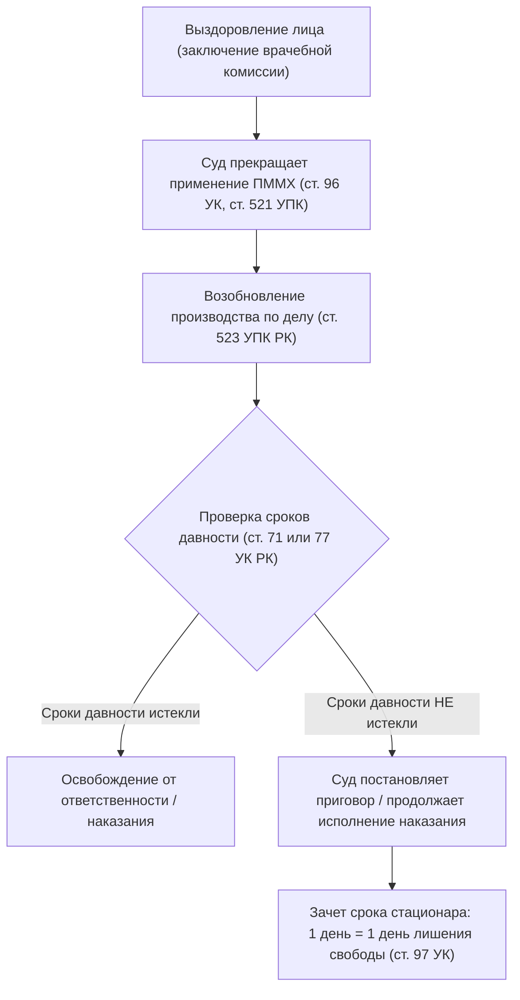

# Дополнения к конспектам по Уголовному праву РК (Общая часть)
> Чанк: up-8 (Вопросы: up-2-55 – up-2-62, up-s-1 – up-s-4)

---

## Вопрос up-2-58. Амбулаторное принудительное наблюдение и лечение у психиатра
> [!info] Чего не хватало в конспекте:
> В конспекте лекции амбулаторное принудительное лечение упомянуто лишь кратко в перечне видов без раскрытия детальных материальных оснований ст. 94 УК РК, механизмов диспансерного учета, взаимодействия медицинских организаций с органами внутренних дел (полицией) и процедуры перевода в стационар при ухудшении состояния.

### Конспект для вставки в Obsidian:
#### 1. Основания и критерии назначения амбулаторной ПММХ (ст. 94 УК РК)
Амбулаторное принудительное наблюдение и лечение у психиатра назначается судом при наличии общих оснований применения ПММХ (ст. 91 УК РК), если лицо по своему психическому состоянию **не нуждается в помещении в психиатрический стационар**.

Суд оценивает совокупность двух критериев:
- **Медицинский критерий:** психическое расстройство протекает без выраженных психотических явлений (стойкая ремиссия, неврозоподобный дефект, психопатия, легкая интеллектуальная недостаточность);
- **Юридический (социальный) критерий:** характер совершенного деяния и личность деликвента свидетельствуют о том, что лицо не представляет явной физической опасности для окружающих, способно контролировать свое поведение в социуме при условии систематического приема психофармакотерапии.

#### 2. Субъекты применения амбулаторного лечения
1. Лица, совершившие деяния в состоянии невменяемости (ст. 16 УК РК), не представляющие повышенной опасности;
2. Лица, переведенные судом из психиатрических стационаров общего или специализированного типа в порядке ступенчатой деэскалации при стойком улучшении состояния (ст. 96 УК РК);
3. Лица с ограниченной вменяемостью (ст. 17 УК РК) и страдающие наркологическими заболеваниями, осужденные к наказаниям, не связанным с изоляцией от общества (штраф, исправительные работы, ограничение свободы — ст. 98 УК РК);
4. Лица, к которым применена амбулаторная химическая кастрация (п. «д» ч. 1 ст. 91 УК РК).

#### 3. Организация исполнения и взаимодействие с ОВД
- Исполнение возложено на организации первичной медико-санитарной помощи (психоневрологические и наркологические диспансеры по месту жительства лица);
- Лицо ставится на специальный диспансерный учет и обязано регулярно являться на осмотр к участковому врачу-психиатру;
- Контроль за поведением лица по месту жительства и содействие медикам в обеспечении явки осуществляют **участковые инспекторы органов внутренних дел**;
- При уклонении лица от явки или приеме препаратов органы внутренних дел осуществляют его принудительное доставление в медицинскую организацию.

#### 4. Замена амбулаторного лечения на стационарное (ч. 2 ст. 96 УК РК)
Если в процессе амбулаторного лечения психическое состояние лица ухудшается либо лицо систематически нарушает предписанный режим терапии, создавая угрозу для себя или окружающих, администрация диспансера направляет в суд мотивированное представление. Суд в порядке **ст. 521 УПК РК** выносит постановление о замене амбулаторного лечения на принудительное лечение в **психиатрическом стационаре**.

**Связи:** [[Принудительные меры медицинского характера]], [[Понятие и цели наказания. Иные меры уголовно-правового воздействия]]

---

## Вопрос up-2-61. Назначение наказания после применения принудительных мер медицинского характера
> [!info] Чего не хватало в конспекте:
> В конспекте раздел о ст. 97 УК РК сведен исключительно к краткой формуле зачета срока (1:1). Не отражены процессуальные основы приостановления и возобновления уголовного дела (ст. 523 УПК РК), правила проверки сроков давности уголовного преследования (ст. 71 УК) и обвинительного приговора (ст. 77 УК), специфика постановления обвинительного приговора после выздоровления лица и недопустимость зачета амбулаторного лечения.

### Конспект для вставки в Obsidian:
#### 1. Круг субъектов института (ст. 97 УК РК)
Нормы ст. 97 УК РК применяются **исключительно** к лицам, у которых тяжелое психическое расстройство наступило **после совершения уголовного правонарушения** либо во время отбывания наказания (п. «б» ч. 1 ст. 91, ст. 75 УК РК).

> [!WARNING] Разграничение с невменяемостью
> Лица, совершившие деяние в состоянии невменяемости (ст. 16 УК РК), уголовному наказанию не подлежат в принципе. Выздоровление невменяемого лица влечет лишь прекращение ПММХ, но никогда не влечет привлечения к уголовному наказанию.

#### 2. Процессуальный алгоритм при выздоровлении лица

#### 3. Правила зачета и исчисления сроков (ч. 2 ст. 97 УК РК)
- **Формула зачета:** Время пребывания в психиатрическом стационаре засчитывается в срок назначенного наказания из расчета: **1 день в стационаре = 1 день лишения свободы**;
- **Амбулаторное лечение:** Время нахождения лица на принудительном амбулаторном наблюдении и лечении у психиатра в срок лишения свободы **не засчитывается**;
- Если к моменту выздоровления срок нахождения в стационаре (с учетом зачета) покрыл назначенный приговором срок наказания, лицо освобождается от дальнейшего отбывания наказания полностью.

**Связи:** [[Принудительные меры медицинского характера]], [[Освобождение от наказания]]

---

## Вопрос up-s-3. Освобождение несовершеннолетних от ответственности и наказания. Сроки давности и погашение судимости для несовершеннолетних
> [!info] Чего не хватало в конспекте:
> В конспекте лекции по несовершеннолетним полностью отсутствовало упоминание ст. 90 УК РК о возможности распространения положений ювенального Раздела 6 на совершеннолетних лиц в возрасте от 18 до 21 года, а также процессуальные основания и исключения из данного правила.

### Конспект для вставки в Obsidian:
#### 1. Применение положений ювенального права к лицам в возрасте от 18 до 21 года (ст. 90 УК РК)
Статья 90 УК РК закрепляет исключительный гуманистический институт «продленной ювенальной юстиции»:

> [!LAW] Статья 90 УК РК
> В исключительных случаях с учетом характера совершенного деяния и личности суд может применить положения настоящей главы к лицам, совершившим уголовные правонарушения в возрасте **от восемнадцати до двадцати одного года**, кроме помещения их в специальную организацию образования либо организацию образования с особым режимом содержания.

#### 2. Условия применения ст. 90 УК РК:
1. **Возрастной ценз:** на момент совершения правонарушения лицу исполнилось 18 лет, но не исполнилось 21 года;
2. **Исключительный характер:** применяется не автоматически, а по мотивированному судебному усмотрению;
3. **Критерии оценки:**
   - уровень социально-психологической зрелости (отставание в развитии, инфантилизм, отсутствие криминального опыта);
   - характер содеянного (не должно быть сопряжено с изощренной жестокостью, терроризмом или циничным насилием);
   - условия жизни и воспитания в семье;
4. **Объем льгот, распространяемых на лиц от 18 до 21 года:**
   - усеченная система наказаний и пониженные пределы лишения свободы (ст. 81, 82 УК РК);
   - льготные пороговые доли для применения УДО: 1/3 по тяжким преступлениям, 1/2 по особо тяжким (ст. 87 УК РК);
   - сокращенные наполовину сроки давности привлечения к ответственности и давности приговора (ст. 88 УК РК);
   - ускоренные сроки погашения судимости: 6 месяцев, 1 год, 3 года (ст. 89 УК РК);
5. **Прямой законодательный запрет:** лиц в возрасте от 18 до 21 года **запрещено направлять в специальную организацию образования** (ст. 85 УК), так как данные учреждения предназначены исключительно для несовершеннолетних детей.

**Связи:** [[Уголовная ответственность несовершеннолетних]], [[Освобождение от уголовной ответственности]], [[Освобождение от наказания]]

---

## Вопрос up-s-4. Иные меры уголовно-правового воздействия (принудительный платёж, конфискация и др.)
> [!info] Чего не хватало в конспекте:
> В конспектах не было четкого разграничения между конфискацией имущества как дополнительным наказанием (ч. 1 ст. 48 УК РК) и специальной конфискацией как иной мерой уголовно-правового воздействия (ч. 2–4 ст. 48 УК, гл. 70 УПК РК), а также специфики института конфискации in rem без вынесения приговора суда.

### Конспект для вставки в Obsidian:
#### 1. Двухколейная система уголовного принуждения (ч. 2 ст. 2 УК РК)
- **Колея I: Уголовные наказания (ст. 39–51 УК РК)** — основываются на вине, каре, возмездии за содеянное и влекут судимость;
- **Колея II: Иные меры уголовно-правового воздействия (Раздел 7 УК РК)** — преследуют цели превенции, лечения, реституции и контроля, не содержат элемента кары и не влекут судимости.

#### 2. Сравнительный анализ институтов конфискации
| Критерий разграничения | Конфискация как наказание (ч. 1 ст. 48 УК РК) | Специальная конфискация как иная мера (ч. 2–4 ст. 48 УК РК) | Конфискация до приговора (in rem, гл. 70 УПК РК) |
| :--- | :--- | :--- | :--- |
| **Правовая природа** | Дополнительное уголовное наказание | Иная мера уголовно-правового воздействия | Процессуальная квазигражданская мера пресечения обогащения |
| **Основание применения** | Только если конфискация прямо указана в санкции Особенной части | Назначается по **любому** составу уголовного правонарушения | Смерть лица, розыск, прекращение дела по нереабилитирующим основаниям |
| **Объект изъятия** | Имущество, находящееся в собственности осужденного (добытое законно или незаконно) | 1) Орудия и средства совершения деликта; 2) добытое преступным путем имущество; 3) средства финансирования терроризма | Активы подозреваемого, происхождение которых не подтверждено законными источниками |
| **Наличие вины** | Требует установления вины обвинительным приговором | Применяется и к невменяемым, и при освобождении от ответственности | Применяется **до** установления виновности в уголовном суде |

#### 3. Институт установления особых требований к поведению лица (ст. 98-3 УК РК)
Назначается судом на срок **от 3 месяцев до 1 года** как при осуждении лица, так и при освобождении от ответственности (например, при примирении по ст. 68 УК РК):
- Запрет разыскивать, преследовать, посещать потерпевшего и членов его семьи;
- Запрет на ношение оружия;
- Запрет на употребление алкоголя и наркотических средств;
- Обязательное прохождение курса психологической коррекции (психопомощи).
Нарушение установленных ограничений квалифицируется как преступление против правосудия по **ст. 430 УК РК**.

**Связи:** [[Понятие и цели наказания. Иные меры уголовно-правового воздействия]], [[Принудительные меры медицинского характера]]
